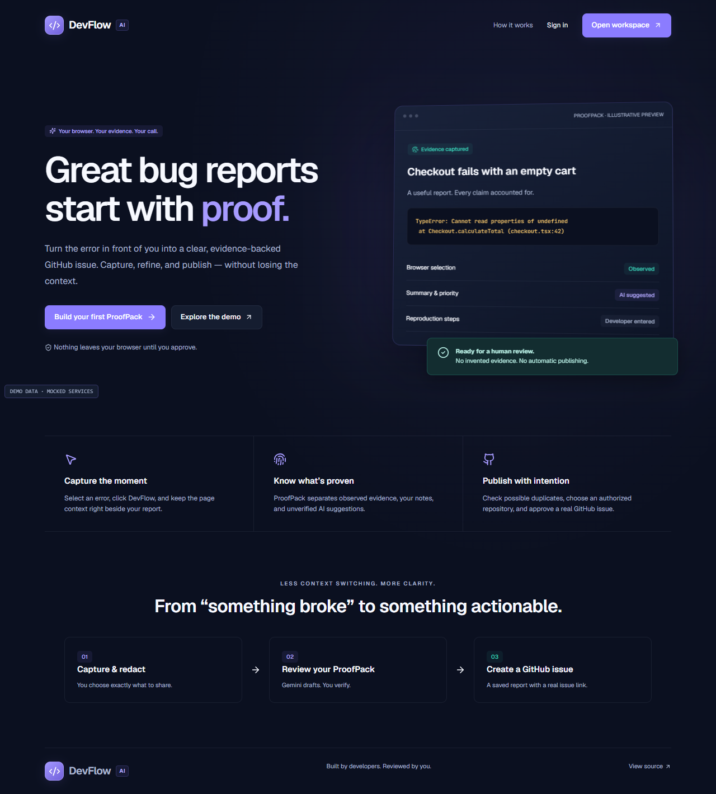
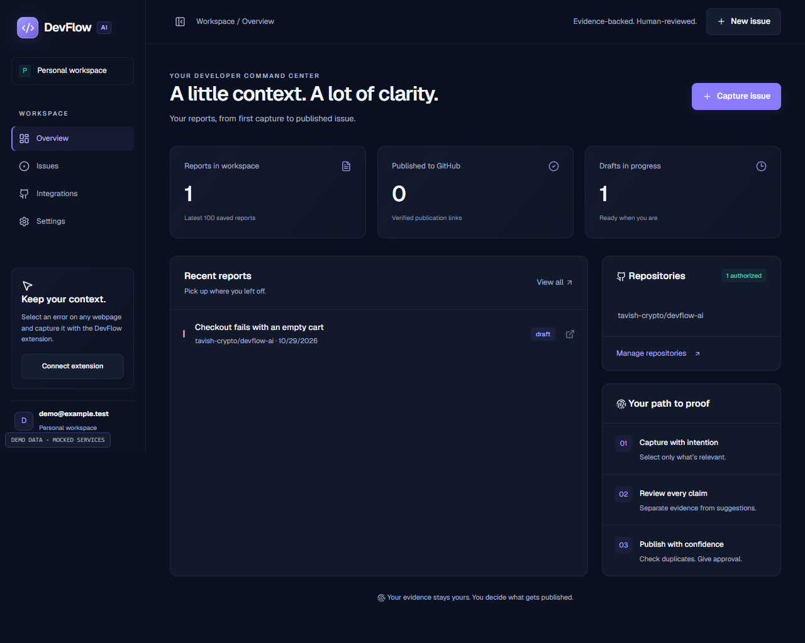
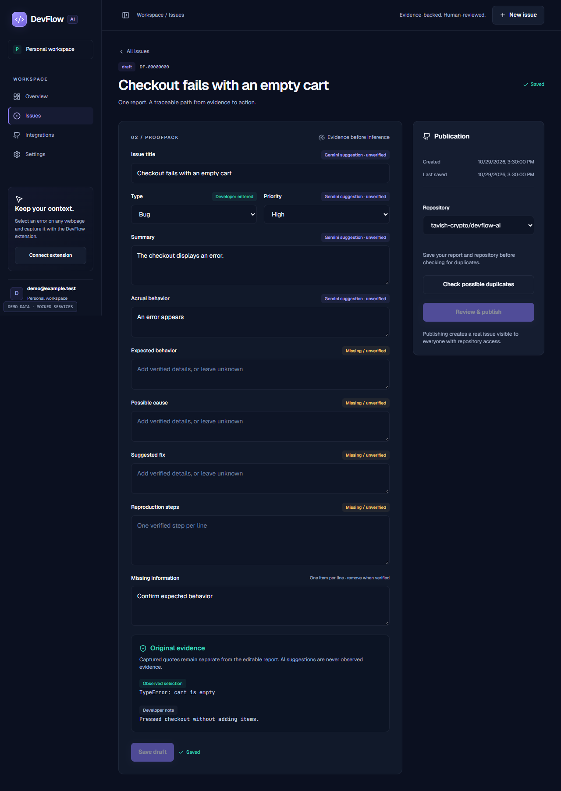

# DevFlow AI

**From browser errors to verified GitHub issues.** Capture the relevant text, review a Gemini-assisted ProofPack, check possible duplicates, and approve a real issue in your authorized repository.

Built on Tavish’s backend by **Kartik Sharma (Horror-Novel)**. Next.js App Router dashboard, WXT React Chrome side panel, Supabase Auth/PostgreSQL, Gemini, GitHub App, and shared Zod contracts.



## A report with a traceable source

- Toolbar-triggered capture of selected text, title, HTTP(S) URL, and timestamp. Manual entry handles restricted pages or empty selections.
- Explicit evidence review, redaction, and consent before AI analysis. A clearly labeled editable fallback handles unavailable Gemini.
- ProofPack fields distinguish original observed selections, developer notes, generated suggestions, and missing information. No AI claim becomes observed evidence.
- Local recovery, ten archived extension drafts, saved private account reports, searchable/filterable issue history, and responsive layouts.
- Secure five-minute pairing, one-hour scoped extension sessions, and dashboard session revocation. Provider credentials stay on the server.
- Repository selection, possible duplicate review, explicit publication, stable idempotency, real GitHub links, and reconciliation for uncertain outcomes.

Publication takes place in the signed-in dashboard. The extension’s scoped token deliberately cannot access GitHub operations; “Review & publish” opens the saved report in the dashboard.

## Start locally

Use **Node 24 LTS** and **pnpm 11.25.0**.

```sh
corepack enable
pnpm install --frozen-lockfile
# Copy .env.example to apps/web/.env.local and configure your services.
pnpm dev
```

On PowerShell, copy with `Copy-Item .env.example apps/web/.env.local`. Configure Supabase and apply the existing migration to your intended project as described in [Environment setup](docs/ENV_SETUP.md). The private dashboard redirects to `/login`; without provider configuration, the landing and safe `/demo` app remain available, while private APIs fail closed.

Build the extension with `pnpm --filter @devflow/extension build`. In Chrome, open `chrome://extensions`, enable Developer mode, choose **Load unpacked**, and select `apps/extension/.output/chrome-mv3`. Pin DevFlow. Add its exact `chrome-extension://ID` origin to the backend’s `ALLOWED_EXTENSION_ORIGINS`, then restart the backend.

The extension defaults to `http://localhost:3000`. For a deployment, set `VITE_DEVFLOW_APP_URL=https://YOUR_APP` **when building the extension**. Only that backend origin is host-permitted. On PowerShell: `$env:VITE_DEVFLOW_APP_URL='https://YOUR_APP'; pnpm --filter @devflow/extension build`.

1. Sign in at `/login` using a real Supabase magic link.
2. Install and authorize the GitHub App at `/dashboard/integrations`.
3. In the extension, connect your workspace; enter and approve its code at `/connect-extension`.
4. Select an error on a webpage and click the **toolbar icon**. Review/redact, approve analysis, edit the report, and save.
5. Open the report in the dashboard, save an authorized repository, check duplicates, acknowledge that the report is distinct, and confirm publication.
6. Open the returned GitHub link. If the outcome is uncertain, reload/reconcile; never blindly retry.

## Verify

```sh
pnpm format:check
pnpm lint
pnpm typecheck
pnpm test
pnpm test:db
pnpm build
pnpm exec playwright install --with-deps chromium
pnpm test:e2e
node scripts/check-secrets.mjs
node scripts/check-browser-bundles.mjs
```

`test:db` uses disposable local PostgreSQL and never reads `DATABASE_URL`. Browser tests use a test-only local Auth provider and mocked API responses; the application contains no production auth bypass. They exercise the real built dashboard and unpacked extension, not live Supabase, Gemini, or GitHub. [Exact results and limitations](docs/TEST_RESULTS.md).

On the implementation Windows host, downloaded Chromium fails before launch with a side-by-side assembly error. An isolated installed Chrome 156 works: `$env:DEVFLOW_TEST_CHANNEL='chrome'; pnpm test:e2e`. Bundled Chromium is supported for running the browser suite on Linux. See [Browser verification](docs/BROWSER_TESTING.md).

## Product views

The following screenshots use **explicitly labeled demo fixtures and mocked services**. They are not production usage metrics or proof of live external integration.




## Documentation

- [Product and permission guide](docs/PRODUCT_GUIDE.md)
- [Architecture](docs/ARCHITECTURE.md) · [API contract](docs/API_CONTRACT.md)
- [Integration audit and engineering changes](docs/INTEGRATION_AUDIT.md)
- [Security](docs/SECURITY.md) · [AI workflow](docs/AI_WORKFLOW.md)
- [Demo, pitch, judge Q&A, and benchmark protocol](docs/DEMO.md)
- [Final handoff and remaining external setup](docs/HANDOFF.md)

Live service validation needs privately configured Supabase/Gemini/GitHub App credentials. No hosted migration, deployment, or real issue creation is implied by mocked tests. Production ingress throttling, retention/deletion policies, CSP nonces, multi-installation selection, and OAuth refresh remain documented limitations.
